 

  

🎀 **Frontend Developer** ㅤ·ㅤ ☁️ **Data Engineer** ㅤ·ㅤ 🤖 **AI Engineer** 

 

 

## 🌸 About Me

### 🎓 Education

**한성대학교 IT공과대학 컴퓨터공학부**
- 웹공학 / 빅데이터트랙
- 2023.03 ~ 2026.08 | 조기졸업 🎓

 

### 🎀 Activities

#### 🐞 BUG | 학술소모임

- **운영진** | 2023.09 ~ 2024.09
- **회장** | 2024.09 ~ 2025.09

 

#### 🦁 LIKELION | 멋쟁이사자처럼

- **12기 아기사자** | 2024.03 ~ 2024.12
- **13기 프론트엔드 운영진** | 2025.03 ~ 2025.12
- **14기 대표** | 2026.01 ~ Present

 

#### 🔬 PRISM Lab | 지능형 추천 시스템 연구실

- **학부연구생 및 랩장** | 2025.08 ~ 2026.08
- 🔗 [PRISM Lab 바로가기](https://sites.google.com/view/prism-lab/home?authuser=0)

 

 

## 📜 Certifications

☁️ **ADsP | 데이터분석 준전문가**
- 2026.06 | 한국데이터산업진흥원

🌷 **SQLD | SQL 개발자**
- 2025.09 | 한국데이터산업진흥원

 

 

## 🏆 Awards

🥇 **한성 SW중심대학 페스티벌 대상**
- 2025.11.28 | 한성대학교

☁️ **508 포텐데이 우수상**
- 2025.08.26 | 네이버클라우드

🦁 **교내 해커톤 대상**
- 2024.05.31 | 멋쟁이사자처럼 한성대학교

 

 
<h2>🍰 Tech Stacks</h2>

  <h3>🧁 Frontend</h3>

  

    

  <h3>🫧 Languages & Database</h3>

  

    

  <h3>🎨 Design & Tools</h3>

  

 

 
<h2>💌 Contact Me</h2>

  

  

 

 
<h2>🐰 My Contribution Garden</h2>

  

 

 
<h2>🍓 My Coding Streak</h2>

  

 

 
<h3>୨୧ Thanks for visiting! ୨୧</h3>

